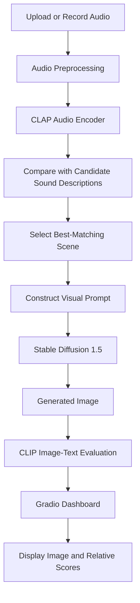
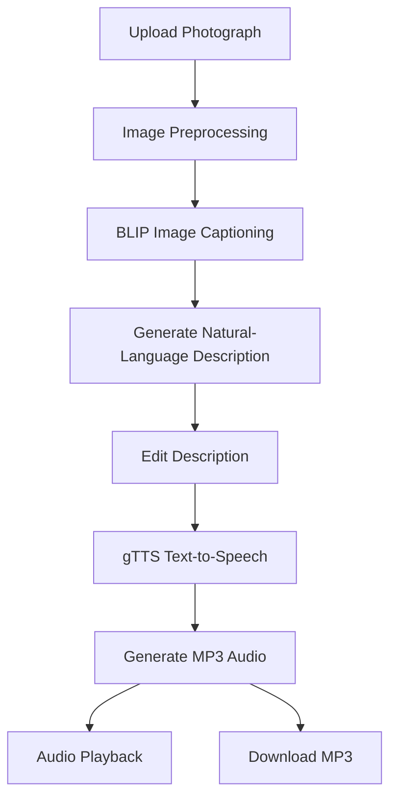

# AI-Powered Audio and Image Generation Suite

An AI-powered multimedia application that transforms environmental audio into generated visual scenes and converts photographs into natural-language descriptions with spoken audio. Built using pretrained deep learning models, Hugging Face Transformers, Stable Diffusion, and Gradio.

## Project Overview

This project contains two AI applications:

**1. Audio Scene-to-Image Generator**

Analyzes environmental audio, identifies the most likely sound category, generates a corresponding image using Stable Diffusion, and evaluates the generated image against candidate scene descriptions using CLIP.

**2. Image-to-Description-to-Speech Generator**

Accepts an uploaded photograph, generates a natural-language caption using BLIP, converts the caption into speech using Google Text-to-Speech (gTTS), and provides an MP3 file for download.

## Features

### Audio Scene-to-Image Generator
- Upload environmental audio or record it using a microphone.
- Classify audio using Contrastive Language-Audio Pretraining (CLAP).
- Identify the most relevant scene from 18 predefined sound categories.
- Generate realistic images using Stable Diffusion 1.5.
- Evaluate image-text similarity using CLIP.
- Display the top predicted sound categories with relative scores.
- Customize the image prompt, generation steps, and random seed.
- Interactive web interface built with Gradio.

### Image-to-Description-to-Speech Generator
- Upload images in common formats, including JPG, JPEG, and PNG.
- Generate image captions using the BLIP image-captioning model.
- Edit the generated description before converting it into speech.
- Generate natural English speech using gTTS.
- Listen to the generated audio directly in the application.
- Download the spoken description as an MP3 file.
- Generate speech again after editing the description.
  


## System Architecture

### Application 1: Audio-to-Image Pipeline



### Application 2: Image-to-Speech Pipeline



## Technology Stack

| Component | Technology | Purpose |
|---|---|---|
| Programming language | Python | Application development |
| Deep learning | PyTorch | Model inference and tensor operations |
| Audio preprocessing | Librosa | Loading, resampling, and preprocessing audio |
| Audio understanding | CLAP | Matching environmental audio with text descriptions |
| Image generation | Stable Diffusion 1.5 | Generating images from text prompts |
| Image-text evaluation | CLIP ViT-B/32 | Comparing images with candidate text descriptions |
| Image captioning | BLIP | Generating descriptions of uploaded photographs |
| Text-to-speech | Google Text-to-Speech (gTTS) | Converting descriptions into spoken audio |
| Model integration | Hugging Face Transformers | Loading pretrained AI models |
| Image generation pipeline | Hugging Face Diffusers | Running Stable Diffusion |
| User interface | Gradio | Interactive browser-based applications |
| Data processing | NumPy, Pandas | Numerical operations and displaying prediction scores |
| Development environment | Google Colab | Running notebook cells and accessing GPU resources |

## AI Models

| Model | Model identifier | Function |
|---|---|---|
| CLAP | `laion/clap-htsat-unfused` | Audio-to-text similarity and sound classification |
| Stable Diffusion 1.5 | `stable-diffusion-v1-5/stable-diffusion-v1-5` | Text-to-image generation |
| CLIP | `openai/clip-vit-base-patch32` | Image-text similarity evaluation |
| BLIP | `Salesforce/blip-image-captioning-base` | Image caption generation |

The applications use pretrained models and perform inference without training a new model.

## Supported Audio Categories

The audio-to-image application currently supports 18 predefined scene categories:

1. Rain
2. Thunderstorm
3. Ocean Waves
4. Birds
5. Forest
6. Traffic
7. Train
8. Aircraft
9. Dog
10. Cat
11. Fire
12. Wind
13. People Talking
14. Applause
15. Footsteps
16. Cooking
17. Machinery
18. Music

The audio classifier selects the best-matching category from these candidates. You can extend the `SCENES` dictionary with additional audio descriptions and corresponding visual prompts.

## Getting Started

### Option 1: Run on Google Colab (Recommended)

Google Colab is recommended because Stable Diffusion image generation benefits from GPU acceleration.

**Step 1: Clone or download the repository**

```bash
git clone https://github.com/pranav120705/AI-Powered-Audio-and-Image-Generation-Suite.git
cd YOUR_REPOSITORY
```

Replace the repository URL with your actual GitHub repository URL.

**Step 2: Upload the notebook**

Upload `Audio_Scene_to_Image_Generator.ipynb` to Google Colab, or open the notebook directly from your GitHub repository.

**Step 3: Enable GPU acceleration**

In Google Colab:

1. Open **Runtime**.
2. Select **Change runtime type**.
3. Choose **T4 GPU**, if available.
4. Save the settings.

**Step 4: Install the dependencies**

Run the following command in a notebook cell:

```python
%pip install -q torch transformers diffusers accelerate \
    librosa gradio numpy pandas pillow gTTS sentencepiece
```

**Step 5: Execute the notebook**

Run the cells in their intended order. The notebook contains separate implementations for the two applications. Execute the relevant application cells to load their models and launch the corresponding Gradio interface.

The first execution downloads the pretrained model weights and may take several minutes.

**Step 6: Open the application**

When the Gradio interface launches, open the generated interface link. Upload an audio clip or photograph, depending on the application you want to use.

### Option 2: Run Locally

Create and activate a Python virtual environment, install the dependencies listed above, and run the notebook using Jupyter.

```bash
python -m venv .venv
```

On Windows:

```bash
.venv\Scripts\activate
```

On Linux or macOS:

```bash
source .venv/bin/activate
```

Install the dependencies:

```bash
pip install torch transformers diffusers accelerate librosa gradio numpy pandas pillow gTTS sentencepiece jupyter
```

Launch Jupyter:

```bash
jupyter notebook
```

Open the project notebook and execute the cells in order.

**Note:** Local execution requires sufficient memory and storage for the pretrained models. A compatible NVIDIA GPU is recommended for faster image generation. CPU execution may be significantly slower.

## Usage Instructions

### Generate an Image from Audio

1. Launch the Audio Scene-to-Image Generator.
2. Upload an environmental sound recording or record audio using your microphone.
3. Optionally enter a custom image prompt.
4. Adjust the generation steps and random seed if required.
5. Run the generation process.
6. Review the predicted sound category, relative classification scores, generated image, and CLIP evaluation results.

### Generate Speech from an Image

1. Launch the Image-to-Description-to-Speech Generator.
2. Upload a photograph.
3. Generate the image description.
4. Review and edit the generated text.
5. Generate the spoken description.
6. Listen to the result or download the MP3 file.

## Configuration

### Image Generation Settings

The audio-to-image application exposes the following settings:

- **Generation steps:** Controls the number of denoising steps used by Stable Diffusion. Higher values may increase generation time.
- **Random seed:** Helps reproduce generation results under the same model, software, and configuration.
- **Custom image prompt:** Allows users to provide an alternative visual description instead of relying entirely on the detected audio category.

The notebook also defines the audio, image-generation, and CLIP model identifiers in its configuration section.

### Image Captioning Settings

The image-to-speech application uses the BLIP image-captioning model. The generated caption can be edited before speech synthesis, allowing users to correct or customize the spoken output.

The gTTS component requires an internet connection.

## Project Structure

```text
AI-Multimedia-Generation/
├── Audio_Scene_to_Image_Generator.ipynb
├── README.md
├── requirements.txt
├── screenshots/
│   ├── audio-to-image.png
│   └── image-to-speech.png
└── .gitignore
```

This is a suggested repository structure. The notebook currently contains both applications, so the screenshot and dependency files should be added separately if you want to use this layout.

## Troubleshooting

| Problem | Possible solution |
|---|---|
| Image generation is slow | Enable a GPU runtime in Google Colab. |
| CUDA out-of-memory error | Reduce generation steps, restart the runtime, or use a GPU with more available VRAM. |
| Audio category is incorrect | Use a clearer recording and consider adding more representative candidate descriptions. |
| Model loading takes a long time | Allow the initial model downloads to finish and maintain an internet connection. |
| gTTS fails | Check the internet connection and try generating speech again. |
| Audio input is empty or silent | Upload a valid recording containing audible environmental sounds. |
| Generated image does not match the audio | Refine the visual prompt or expand the supported scene descriptions. |

## Limitations

- Audio classification is restricted to the predefined sound categories.
- CLAP and CLIP scores are relative comparisons among the candidate descriptions, not calibrated probabilities.
- Stable Diffusion generates an AI interpretation of the selected scene; the output does not establish what was actually present when the audio was recorded.
- Image-captioning models can omit details or produce inaccurate descriptions.
- gTTS requires internet access.
- Performance depends on available hardware, model download time, and memory.
- The applications are demonstrated through notebook-based Gradio interfaces; a persistent production deployment requires additional configuration.

## Future Enhancements

- Add open-vocabulary audio understanding to support a wider range of environmental sounds.
- Improve scene descriptions using a language model.
- Add support for multiple languages and voices in speech generation.
- Introduce batch audio and image processing.
- Provide user authentication, request limits, and persistent storage for a hosted version.
- Deploy the applications using Docker and a cloud GPU service.
- Add evaluation datasets and systematic metrics for classification and caption quality.

## Applications

- Environmental sound visualization
- Accessibility tools for converting visual information into speech
- Educational multimedia systems
- Audio-driven creative content generation
- Assistive applications for describing photographs
- Interactive demonstrations of multimodal AI

## Acknowledgements

This project uses pretrained models and libraries from Hugging Face, the PyTorch ecosystem, Gradio, and Google Text-to-Speech.

Please review the model cards and applicable licenses before redistributing models or deploying the application commercially.

## License

Choose a license appropriate for your repository, such as the MIT License, and add a `LICENSE` file if you intend to distribute the project under those terms. Verify the applicable licenses of the pretrained models and dependencies separately.

---

**Built with Python, PyTorch, Hugging Face, Stable Diffusion, CLAP, CLIP, BLIP, and Gradio.**
